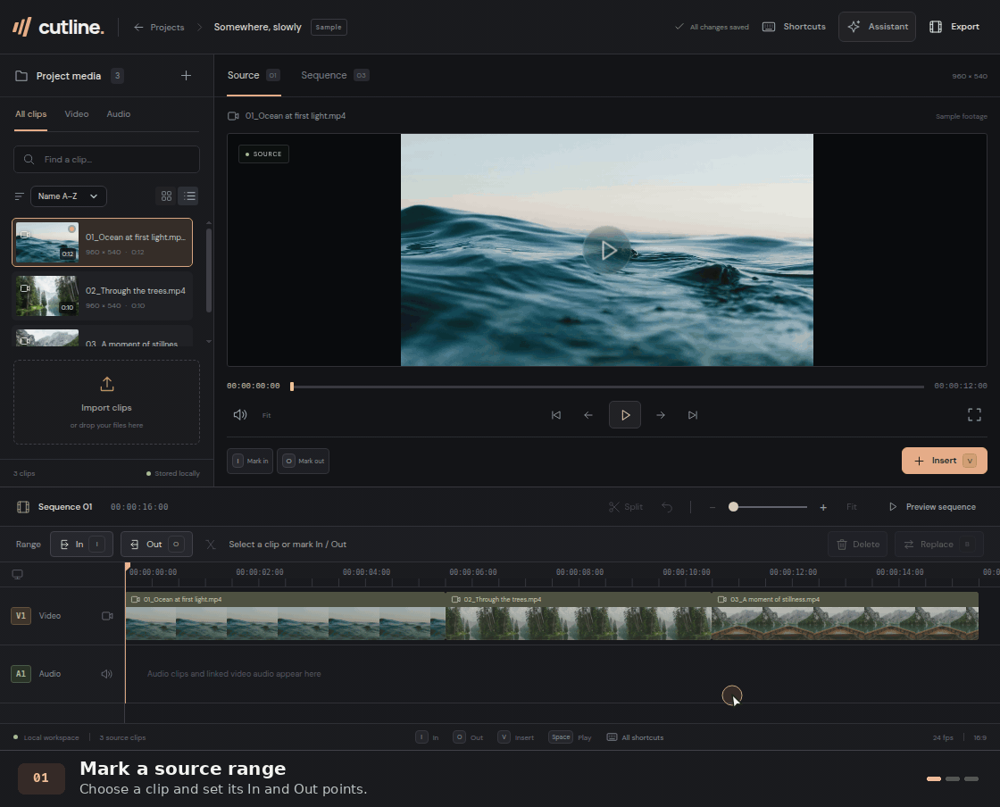

# Cutline

Cutline is a desktop video editor for assembling footage, cleaning up spoken recordings, and exporting finished videos. It links to your original media and saves project edits on your device.



*Editing the included **Somewhere, slowly** sample project in the browser preview.*

## Features

- **Timeline editing.** Import video and audio, mark source ranges, split or replace clips, and undo edits. Linked audio follows its video cuts, and waveforms help you find edit points.
- **Speech cleanup.** Transcribe and align words locally with Whisper, then use the desktop assistant to draft cuts for false starts, repeated words and takes, and quiet gaps. The agent audits its draft, preserves unique details, and explains any edits it cannot safely place. Review, preview, apply, and Undo the cuts together. Drafting sends your brief, transcript, and timing evidence to your configured AI provider.
- **MP4 export.** Render up to 4K with selectable frame rate and quality. The desktop app uses NVIDIA hardware encoding when available and falls back to the CPU.

## Quick start

Install Node.js 24 and Bun 1.4.3 to match the desktop CI setup. Run these commands from the repository root.

```sh
bun install --frozen-lockfile
bun run dev
```

Open `http://localhost:1420` and select **Somewhere, slowly** to try the editor. The browser preview supports timeline editing. Use the desktop app for local speech analysis and MP4 export.

Run `bun run test` for the frontend unit tests and `bun run build` to type-check and produce a browser build in `dist/`.

## Build the desktop app

Install stable Rust with `rustup`, CMake, and LLVM's libclang. Python 3 is required for the installer build script. Build on the OS you intend to package for. [Tauri platform prerequisites](https://v2.tauri.app/start/prerequisites/)

On Ubuntu or Debian, install the native build dependencies.

```sh
sudo apt-get update
sudo apt-get install -y build-essential cmake libclang-dev libdbus-1-dev \
  libssl-dev libwebkit2gtk-4.1-dev librsvg2-dev pkg-config python3
```

For Rocky Linux 10, use the EPEL and CRB dependencies in the [RPM build job](.github/workflows/desktop.yml). On Windows, install the Visual Studio **Desktop development with C++** workload, the WebView2 runtime, and the MSVC Rust toolchain. If the build cannot find `libclang.dll`, set `LIBCLANG_PATH` to the LLVM `bin` directory. On macOS, install Xcode Command Line Tools with `xcode-select --install`, plus CMake and LLVM. Set `LIBCLANG_PATH` to LLVM's `lib` directory if libclang cannot be found.

Stop the browser preview before starting Tauri because both use port 1420.

```sh
bun run tauri dev
```

Use the same build helper as CI to make a portable release. Choose the command for your platform.

| Platform | Command |
| --- | --- |
| Debian-based Linux | `python3 scripts/build-speech.py --backend cpu --bundles deb --locked` |
| Rocky Linux 10 | `python3 scripts/build-speech.py --backend cpu --bundles rpm --locked` |
| Windows x64 | `python scripts/build-speech.py --backend cpu --bundles nsis --locked` |
| macOS | `python3 scripts/build-speech.py --backend cpu --bundles dmg --target universal-apple-darwin --locked` |

For the universal macOS build, first run `rustup target add aarch64-apple-darwin x86_64-apple-darwin`. Look for installers under `src-tauri/target/speech-portable-cpu/release/bundle/` or `src-tauri/target/speech-portable-cpu/universal-apple-darwin/release/bundle/` for the universal build. Replace `--bundles <type>` with `--no-bundle` to build only the executable.

These builds include CPU transcription, plus Metal support on macOS. CUDA and Vulkan speech workers are optional and require their corresponding toolkits. The speech build backend is separate from NVENC export. [Speech acceleration builds](docs/editor-guide.md#optional-speech-acceleration-builds)

For desktop waveforms, speech cleanup, and MP4 export, install `ffmpeg` and `ffprobe` separately and make both available on the app's `PATH`. Use an FFmpeg build with the `libx264` and `aac` encoders for CPU export. Whisper and Silero models download on demand when you use speech tools.

[Editor guide](docs/editor-guide.md) · [Performance and testing](docs/performance.md)

## Desktop releases

The [Desktop installers workflow](.github/workflows/desktop.yml) builds four installers on every push to `main`. Download them from the workflow run's **Artifacts** section.

| Download | Target |
| --- | --- |
| `.deb` | Debian-based Linux, x86-64, built on Ubuntu 22.04 |
| `.rpm` | Enterprise Linux 10, x86-64, built on Rocky Linux 10 with EPEL. Enable EPEL and the distro's builder repository for WebKitGTK 4.1. |
| `.exe` | Windows x86-64, NSIS installer |
| `.dmg` | Universal app for Apple Silicon and Intel, with a configured macOS 11 minimum |

To publish, bump `version` in `src-tauri/tauri.conf.json` and merge the change to `main`. After all four builds pass, the workflow creates a GitHub Release and attaches the installers under a tag such as `v0.1.1`. To publish the current version after a failed release build, run **Desktop installers** manually on `main` with **Publish the current version from main** enabled.

## License

Cutline's original software is source-available under the [PolyForm Noncommercial License 1.0.0](LICENSE). It allows personal and other noncommercial use, modification, and redistribution under its terms. It also permits use by the organizations listed in the license. Commercial use outside those terms requires separate permission from the copyright holder. Third-party components and assets retain their own terms. [Third-party notices](THIRD_PARTY_NOTICES.md)

## Before publishing

- **Confirm rights and branding.** Confirm who can license the code, icons, and sample assets. Record redistribution rights for the demo photos, walkthrough, test clips, and the JFK audio embedded in the speech worker. Replace assets whose rights cannot be confirmed. Check the Cutline name in your release markets because another AI video-editing product already uses it. [Existing Cutline product](https://cutlineai.com/legal/licence.html)
- **Prepare notices for every installer.** Ship the project license and the applicable third-party license texts, copyright notices, and source information alongside each release and in the installers. Generate and review a dependency inventory for the locked Rust and frontend versions on each target. Include the corresponding MPL-covered source or directions to obtain it for any MPL components shipped in executable form. [Third-party inventory](THIRD_PARTY_NOTICES.md) · [Mozilla MPL FAQ](https://www.mozilla.org/en-US/MPL/2.0/FAQ/)
- **Review codec terms if distribution changes.** The current workflow leaves FFmpeg installation to the user. If you bundle or host FFmpeg binaries, review the exact build's GPL/LGPL terms, source and notice requirements, and any applicable codec patent terms before distributing them. [FFmpeg licensing guidance](https://ffmpeg.org/legal.html)
- **Document data handling and review security.** Explain what stays local, what the app downloads, and when transcript text and conversation go to the configured AI provider. Review repository history and build artifacts for secrets and private media, scan locked dependencies, and set and test a desktop content security policy. [AI provider behavior](docs/editor-guide.md#ai-providers) · [Tauri config](src-tauri/tauri.conf.json)
- **Set the release identity.** Replace the starter package name, description, and maintainer details. Set the production bundle identifier and credential-store service name before users create projects and save API keys. [Cargo manifest](src-tauri/Cargo.toml) · [Tauri config](src-tauri/tauri.conf.json) · [Credential storage](src-tauri/src/cleanup/providers.rs)
- **Sign and smoke-test releases.** Configure Developer ID signing and notarization for macOS and code signing for Windows. The workflow uses ad hoc signing on macOS when the Apple secrets are absent. Test fresh installs on each target, including media playback, local transcription, and export with system FFmpeg, before triggering publication. [macOS signing](https://v2.tauri.app/distribute/sign/macos/) · [Windows signing](https://v2.tauri.app/distribute/sign/windows/)
